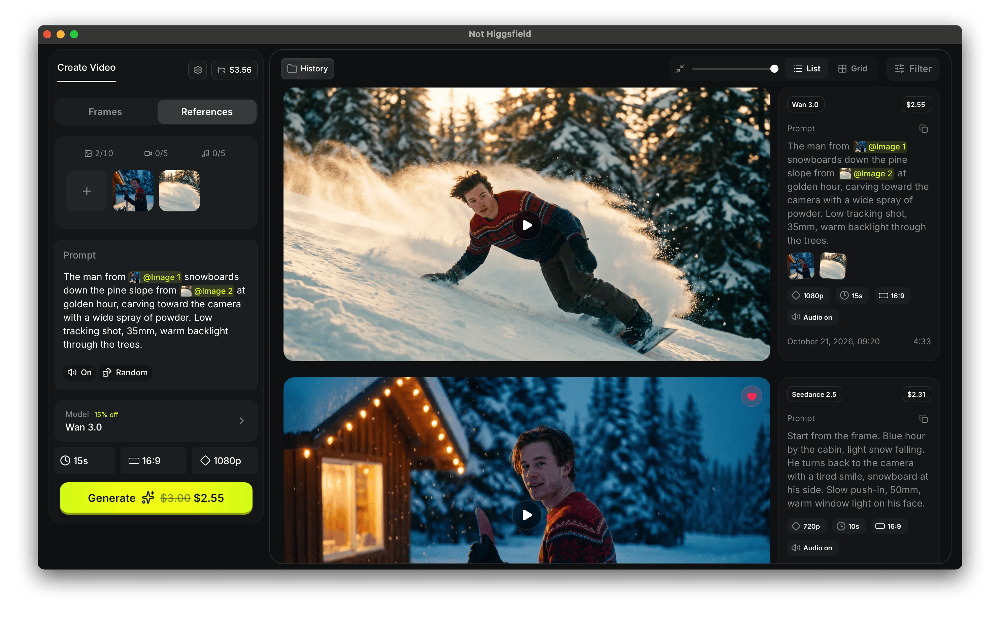

<h1>
  
  
</h1>

> Make AI videos with today's most popular high-quality models on your own computer. Pay the model's price per second through your own OpenRouter key: no subscription, no markup. Every video stays on your computer with its settings and real cost.

## What you can do

- See the price before you press Generate, and keep the real cost with every video.
- Start from text, a picture, or a start and an end picture.
- Add reference pictures, clips or sound, and point to them in your text ("the person in Image 1").
- Browse, search and select many videos at once, and make any of them again with one click.
- Keep working while videos generate. You get a notification when one is ready.

## Models

- Wan 3.0 and Wan 3.0 Prime · 480p-1080p
- Seedance 2.0 · 480p-4K
- Seedance 2.5 · 480p-720p

Prices come live from OpenRouter.

## Wait, is this Higgsfield?

No. That is the whole point of the name.

| Name                   | What it is                                                                                                                                            |
| ---------------------- | ----------------------------------------------------------------------------------------------------------------------------------------------------- |
| Not Higgsfield         | This app. Runs on your computer, uses your own OpenRouter key, keeps every video in a folder you own.                                                 |
| Not Not Higgsfield     | Two negatives cancel out, so this is Higgsfield. A different company with a different product, no relation to this repo. Go there for the real thing. |
| Not Not Not Higgsfield | Back to this app. We stopped counting here.                                                                                                           |

This is a clean-room project. It was written from scratch: no Higgsfield code, assets, logos, private API or internal material went into it. I liked how their app looks from the outside, the way anyone with a browser can see it, and then built our own house next door, with our own bricks.

## What you need

- A Mac (Apple Silicon), a Windows 10/11 PC, or 64-bit Linux with glibc 2.35+ (Ubuntu 22.04, Debian 12, Fedora 36 or newer).
- An OpenRouter account with some credit. One account gives you many video models, and you pay only for what you generate.
- Optional: a Cloudflare account with R2, only for models that take video or sound references. Cloudflare asks for a card to turn R2 on. The free tier is 10 GB, and the app stays under 8 GB.

## Install

Download the file for your computer from the [Releases page](https://github.com/jefoce/not-higgsfield/releases/latest).

### macOS

1. Open the `.dmg` and drag Not Higgsfield into Applications.
2. Before the first launch, run this in Terminal: `xattr -dr com.apple.quarantine "/Applications/Not Higgsfield.app"`
3. If macOS still blocks it, go to System Settings > Privacy & Security, press **Open Anyway** next to Not Higgsfield, and confirm.

> The command is only for the file downloaded from this repo's. It removes Apple's quarantine flag from that copy. Do not run it on an app you got from anywhere else.

### Windows

1. Run the `-setup.exe`.
2. If you see "Windows protected your PC", press **More info**, then **Run anyway**.

No administrator rights needed. The app appears in the Start menu.

### Linux

- **AppImage:** `chmod +x not-higgsfield-*-linux-x64.AppImage`, then run it.
  If it fails with a FUSE or `libfuse.so.2` error, install FUSE 2 once:
  - Ubuntu 22.04 or Debian 12: `sudo apt install libfuse2`
  - Ubuntu 24.04 or newer: `sudo apt install libfuse2t64`

  Install exactly that package, not `fuse`, which replaces `fuse3` and can remove system packages.
  No FUSE at all: `./not-higgsfield-*-linux-x64.AppImage --appimage-extract-and-run`.

- **Debian or Ubuntu:** `sudo apt install ./not-higgsfield-*-linux-x64.deb`. This is the simplest option on Ubuntu, and it also installs the video playback libraries.
- **Fedora or openSUSE:** `sudo dnf install ./not-higgsfield-*-linux-x64.rpm`.

Each release has a `SHA256SUMS.txt` if you want to check your download.

## Messages your computer may show

The app is not signed with a paid certificate yet, so your system asks more questions than usual. They are all normal.

### macOS

| When                                                                              | Message                                                         | Press                                                                                                                |
| --------------------------------------------------------------------------------- | --------------------------------------------------------------- | -------------------------------------------------------------------------------------------------------------------- |
| You save keys                                                                     | "…wants to use your confidential information… in your keychain" | Your login password, then **Always Allow**. Pressed Deny? Save again, or delete "not-higgsfield" in Keychain Access. |
| First video is ready                                                              | "…would like to send you notifications"                         | **Allow**. Change it later in System Settings > Notifications.                                                       |
| You use a folder in Desktop, Documents, Downloads, a USB drive or a network share | "…would like to access files in…"                               | **Allow**. Otherwise turn it on in Privacy & Security > Files and Folders. Until then the folder looks empty.        |

After an update, run the required `xattr` command again before the first launch, then Open Anyway if asked. Each unsigned version counts as a new app. The app never needs Full Disk Access, Accessibility, Screen Recording, Camera or Microphone.

### Windows

| When                                                             | Message                        | Press                                                                        |
| ---------------------------------------------------------------- | ------------------------------ | ---------------------------------------------------------------------------- |
| Installing                                                       | "Windows protected your PC"    | **More info**, then **Run anyway**.                                          |
| Saving to Documents or Pictures with Controlled folder access on | "Unauthorized changes blocked" | Windows Security > Ransomware protection > Allow an app, add Not Higgsfield. |

Keys go to Windows Credential Manager without a question.

### Linux

If your keyring is locked when you save keys, Linux asks for your login password. Cancel it and the keys are not saved, settings tells you. Without any keyring, keys go to a private file in your home folder.

## First setup

You need OpenRouter. Cloudflare R2 is only for video or sound references, so skip it until you want one.
Every link below is also in the app: press the gear icon, each section lists its links.

### 1. OpenRouter

1. Sign up at [openrouter.ai](https://openrouter.ai) and add credit: **Account → [Credits](https://openrouter.ai/settings/credits)**.
2. Create an API key: **Workspace → [API Keys](https://openrouter.ai/workspaces/default/keys) → New Key**.
   - **Name:** `Not Higgsfield`.
   - **Expiration:** shorter is safer. When it ends, videos fail with "Your OpenRouter key is not valid". Create a new key and paste it in again.
   - **Credit limit:** for example 5 dollars, reset every month. A mistake can never spend more.
   - Copy the key now. OpenRouter shows it only once.
3. Optional, shows your balance in the app: **Account → [Management Keys](https://openrouter.ai/settings/management-keys) → New Key**, with a name and an expiration. When it ends, the balance disappears until you paste a new one. A management key can create and delete your API keys, so paste it only into the app.
4. In the app: gear icon → **OpenRouter** → paste the key(s) → **Save** → **Test**.

### 2. Cloudflare R2 (only for video or sound references)

1. Sign up at [cloudflare.com](https://dash.cloudflare.com/sign-up). Open **Storage & databases → [R2 Object Storage](https://dash.cloudflare.com/?to=/:account/r2/overview)** and finish the checkout. Cloudflare asks for a card even for the free tier.
2. **Create bucket:**
   - **Bucket name:** for example `not-higgsfield`. It cannot be changed later. Use this bucket for the app only.
   - **Location:** Automatic. Do not choose "Specify jurisdiction", the app does not support jurisdiction buckets.
   - **Default storage class:** Standard. Infrequent Access has no free tier.
3. Create the keys: on the R2 page, **Account Details → API Tokens → Manage → Create Account API token** ([open](https://dash.cloudflare.com/?to=/:account/r2/api-tokens)).
   - **Permissions:** Object Read & Write.
   - **Specify bucket(s):** only the bucket from step 2.
   - **TTL:** your choice. When it ends, references fail until you create a new token.
   - Create, then copy the **Access Key ID** and **Secret Access Key**. Cloudflare shows the secret only once. The **Account ID** is under Account Details on the R2 page.
4. In the app: gear icon → **Cloudflare R2** → Account ID, Access key ID, Secret access key, Bucket → **Save** → **Test**.

**Costs.**

- Free each month: 10 GB of storage, 1 million uploads and 10 million reads. Downloads are free.
- Above that, Cloudflare charges the card ($0.015 per GB per month).
- The app uploads only video and sound references and shares them as links that expire after 2 hours.
- It deletes files it has not used for 30 days and keeps the total under 8 GB. Settings shows how much is stored.

## Make your first video

1. Pick the cheapest model at 480p and a short length to try.
2. Describe what should happen. Optional: add a start picture (Frames) or references (References), and call them Image 1, Video 1, Audio 1 in your text.
3. Press **Generate**. The button shows the price. You have 10 seconds to cancel before anything is sent or paid.

## Keep the app running until your video is done

The one thing to remember: the video is made on OpenRouter, but the app brings it to your computer. OpenRouter keeps finished videos only for a while (about a day for some models).

- **macOS:** the red close button only hides the window. Quit with Cmd+Q.
- **Windows and Linux:** closing the window quits.
- Quit anyway? Videos keep generating, and the app downloads them when you open it again. Do that within a few hours.
- Don't let the computer sleep for long during a generation.

## What the statuses mean

| Status                | What is happening                                        | OK to quit?                    |
| --------------------- | -------------------------------------------------------- | ------------------------------ |
| Processing            | 10 seconds before sending. Cancel works, nothing charged | Better not                     |
| Uploading             | Sending references to R2, nothing charged                | No, it fails                   |
| Sending               | Handing the job to OpenRouter                            | Yes, it finishes sending first |
| In queue / Generating | Charged when it finishes                                 | Yes, reopen within a few hours |
| Downloading           | Saving to your computer                                  | No, wait a moment              |
| Completed             | Saved                                                    | Yes                            |
| Failed                | Usually not charged. The card says why                   | Yes                            |
| Expired               | Charged if it finished. Check OpenRouter activity        | Yes                            |
| Cancelled             | Never sent, nothing charged                              | Yes                            |

## Where your videos are

Everything is in `.not-higgsfield` in your home folder (hidden, on macOS press Cmd+Shift+. in Finder).

- `downloads`: your videos with a preview and settings for each.
- `uploads`: pictures and clips you pasted or dropped. Files picked from your disk are not copied, only linked.
- `.cache` and `runtime`: thumbnails and the app's server copy. Safe to delete while the app is closed.

To back up or move to a new computer, copy the whole folder, then enter your keys again.

## Costs and privacy

- Not Higgsfield is free and adds no fee. The wallet pill shows what is left on your key.
- No account, no tracking, no server of ours. Keys stay in your system keychain.
- Your text and pictures go to OpenRouter and the model's provider. Video and sound references go to your own R2 bucket as private links that expire after 2 hours.
- R2 stays inside Cloudflare's free tier, see First setup.

## Something went wrong?

| What you see                                                                 | What to do                                                                                                                                                                |
| ---------------------------------------------------------------------------- | ------------------------------------------------------------------------------------------------------------------------------------------------------------------------- |
| "OpenRouter key is not set"                                                  | Save your key in Settings (gear icon).                                                                                                                                    |
| "Your OpenRouter key is not valid"                                           | The key expired or was deleted. Create a new one (First setup, step 1.2) and paste it in Settings.                                                                        |
| "needs cloud storage (R2)"                                                   | Set up R2, or use pictures instead of video or sound.                                                                                                                     |
| "R2 is at the app's 8 GB limit"                                              | Wait 2 hours, or use shorter clips. Older references are removed automatically.                                                                                           |
| "takes video references as mp4 or mov"                                       | Convert the clip to mp4.                                                                                                                                                  |
| A model blocks images that look like real people                             | Use a different image, or another model.                                                                                                                                  |
| "Waiting for keychain access"                                                | A system prompt is open, maybe behind a window. Choose Always Allow.                                                                                                      |
| A video says Expired                                                         | Make it again with Reuse. Check OpenRouter activity for a charge.                                                                                                         |
| Videos don't play on Linux                                                   | Install the `.deb`, or `gstreamer1.0-plugins-good gstreamer1.0-libav`.                                                                                                    |
| Settings says "Keys could not be saved. The system keychain is unavailable." | macOS: open Keychain Access and check the login keychain is unlocked, then press Retry. Windows: sign in to Windows normally (not a temporary profile), then press Retry. |
| Anything else                                                                | Send the last lines of `.not-higgsfield/logs/server.log`.                                                                                                                 |

## Uninstall

Delete the app, then the `.not-higgsfield` folder if you don't want your videos. Remove the saved keys by searching "not-higgsfield" in Keychain Access, Windows Credential Manager or your Linux keyring.

## What's next

Ideas, depending on how many people use the app: more video models, image generation, and simple editing (trim videos, crop and resize pictures). Want one sooner? Open or upvote an issue.

## For developers

[DEVELOPMENT.md](docs/DEVELOPMENT.md) · [ARCHITECTURE.md](docs/ARCHITECTURE.md) · [SECURITY.md](docs/SECURITY.md)

---

Installers bundle custom ffmpeg 9.0.2 (x264, zlib) and Node.js 24 builds from pinned sources. Licenses: [THIRD_PARTY_NOTICES.md](THIRD_PARTY_NOTICES.md).

"Higgsfield" is a trademark of its respective owner. This project is independent and is not affiliated with, sponsored by, or endorsed by Higgsfield AI. The name is used only to describe this app as an alternative.
