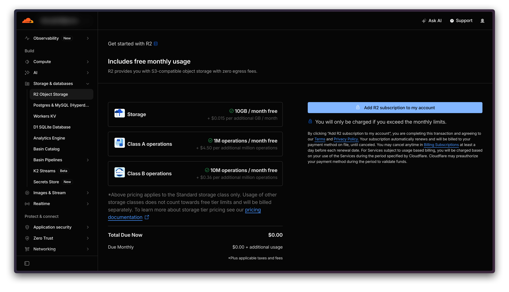
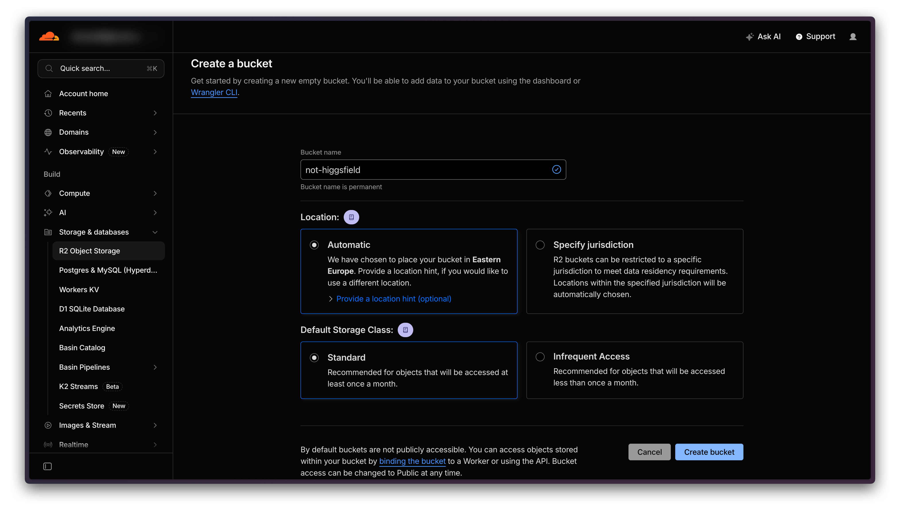
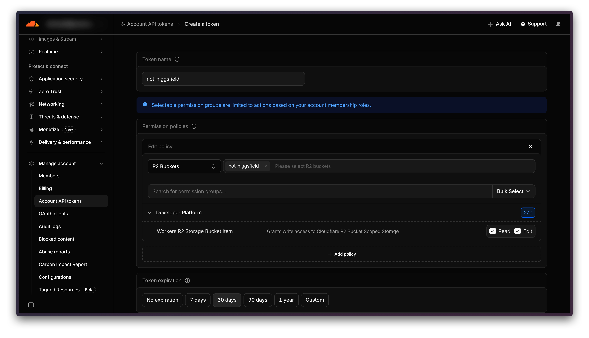
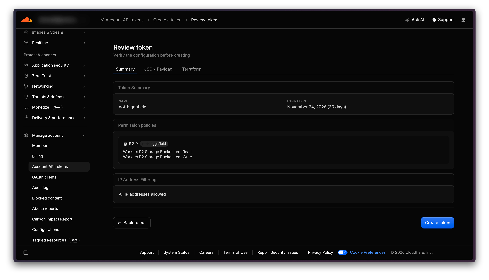

# Cloudflare R2 setup

R2 is Cloudflare's file storage. Not Higgsfield needs it only for models that take **video or sound references**: the app uploads the clip to your bucket and gives the model a private link that works for 2 hours. Pictures never need R2, so skip this guide until you want a video or sound reference.

| | |
|---|---|
| Time | about 5 minutes |
| Cost | free up to 10 GB, and the app stays under 8 GB |
| You need | a Cloudflare account and a card |

> [!NOTE]
> Cloudflare asks for a card to turn R2 on, even on the free tier. The app keeps its files under 8 GB and deletes references it has not used for 30 days, so normal use stays free.

## 1. Turn on R2

Sign in at [dash.cloudflare.com](https://dash.cloudflare.com), open **Storage & databases → [R2 Object Storage](https://dash.cloudflare.com/?to=/:account/r2/overview)** and finish the checkout.

> [!TIP]
> Press **Add Budget Alert** under Billing Dashboard and set it to $1. Cloudflare emails you if anything is ever billed.

## 2. Create a bucket

Press **Create bucket**:

- **Bucket name:** `not-higgsfield`. The name is permanent. Use this bucket for the app only, because the app counts only the files it uploaded.
- **Location:** Automatic. Do not choose **Specify jurisdiction**, the app cannot reach jurisdiction buckets.
- **Default storage class:** Standard. Infrequent Access has no free tier.

## 3. Create a token for that bucket

Open **Manage account → Account API tokens → Create a token**:

- **Token name:** `not-higgsfield`
- **Permission policies:** **R2 Buckets**, pick your bucket, then tick **Read** and **Edit** on **Workers R2 Storage Bucket Item**.
- **Token expiration:** your choice. When it ends, video and sound references fail until you create a new token (steps 3 to 5).
- **Client IP address filtering:** leave empty. Your home IP can change.

Press **Review token**. You should see **R2 › your bucket** with Read and Write. Then press **Create token**.

## 4. Copy the keys

The dialog shows the values only once. The app needs three of them, plus the bucket name:

- **Account ID**
- **Access Key ID**
- **Secret Access Key**

You do not need "Your API Token" or the S3 endpoint. The app builds the endpoint from the Account ID.

> [!WARNING]
> Paste the keys straight into the app, not into notes or a chat. If you lose the secret, delete the token and create a new one.

## 5. Paste the keys into the app

Press the gear icon, find **Cloudflare R2**, fill in Account ID, Access key ID, Secret access key and Bucket, press **Save**, then **Test**. Settings then shows how much the app stores, for example `Stored 0 B of 8 GB`.

## What it costs

| Each month | Free | Above the free tier |
|---|---|---|
| Storage | 10 GB | $0.015 per GB |
| Uploads (Class A) | 1 million | $4.50 per million |
| Reads (Class B) | 10 million | $0.36 per million |
| Downloads | free | free |

Prices from [Cloudflare R2 pricing](https://developers.cloudflare.com/r2/pricing/), October 2026.

What the app does to stay free:

- It uploads only video and sound references, never your pictures or results.
- Links expire after 2 hours.
- It deletes files it has not used for 30 days.
- It keeps the total under 8 GB and removes the oldest unused files first.

## Something went wrong?

| What you see | What to do |
|---|---|
| needs cloud storage (R2) | Finish this guide, or use pictures instead of video or sound. |
| Test fails right after Save | Check all four fields and that the token is scoped to this bucket (step 3). |
| Worked before, fails now | The token expired. Do steps 3 to 5. |
| Cloud storage is full. | References used in the last 2 hours fill the 8 GB. Wait, or use shorter clips. |
