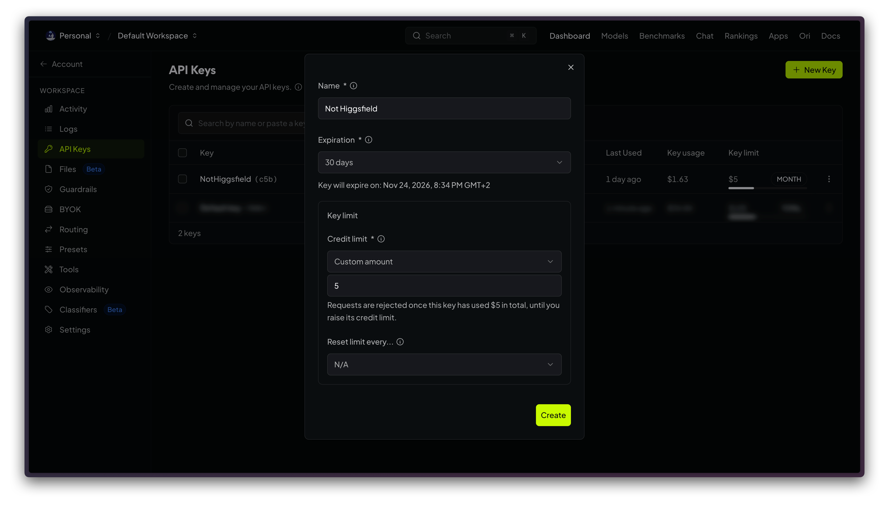
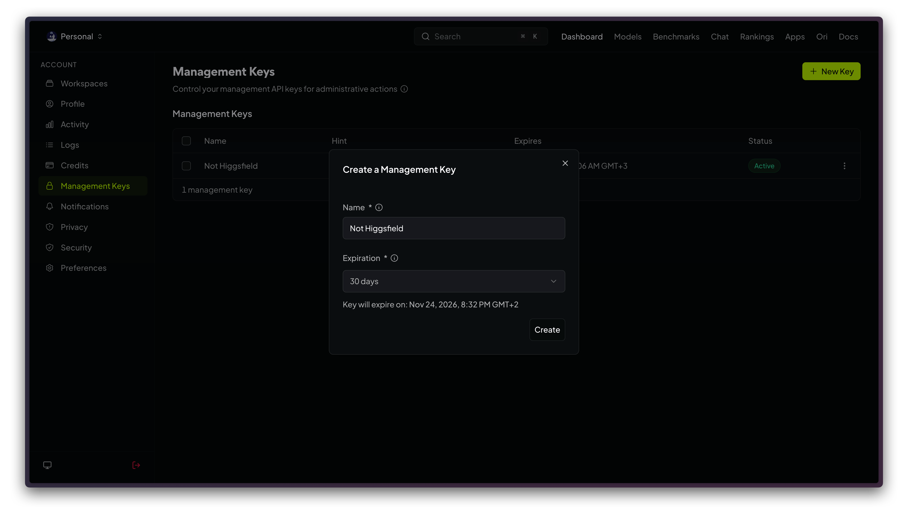

# OpenRouter setup

OpenRouter runs the video models. Not Higgsfield needs one OpenRouter API key, and you pay OpenRouter only for the videos you make.

| | |
|---|---|
| Time | about 3 minutes |
| Cost | pay per video, no subscription |
| You need | an OpenRouter account with some credit |

## 1. Add credit

Sign in at [openrouter.ai](https://openrouter.ai), then open **Account → [Credits](https://openrouter.ai/settings/credits)** and add credit. A few dollars is enough to try every model at 480p.

## 2. Create an API key

Open **Workspace → [API Keys](https://openrouter.ai/workspaces/default/keys) → New Key** and fill in:

- **Name:** `Not Higgsfield`
- **Expiration:** shorter is safer, for example 30 days. When it ends, create a new key (this step) and paste it again.
- **Credit limit:** **Custom amount**, for example `5`. The key stops at $5 in total until you raise the limit. Set **Reset limit every** to Monthly if you want a fresh $5 each month.

Use a dedicated key for this app, with its own spend limit, rather than a key you share with other tools.

Press **Create** and copy the key. It starts with `sk-or-v1-`.

> [!WARNING]
> OpenRouter shows the key only once. Paste it straight into the app, not into notes or a chat.

## 3. Optional: a management key for your balance

Without it the wallet pill shows what is left of the key's credit limit. With it, the pill shows your whole account balance.

Open **Account → [Management Keys](https://openrouter.ai/settings/management-keys) → New Key**, give it a name and an expiration, and press **Create**.

> [!WARNING]
> A management key can create and delete your API keys. Paste it only into the app.

## 4. Paste the keys into the app

Press the gear icon, find **OpenRouter**, paste the API key (and the management key if you made one), press **Save**, then **Test**.

## When a key expires

- **API key:** new videos fail with "Your OpenRouter key is not valid." Create a new key (step 2), paste it, press **Save**.
- **Management key:** the balance disappears from the wallet pill. Create a new one (step 3).

## Something went wrong?

| What you see | What to do |
|---|---|
| Your OpenRouter key is not set. | Do step 4. |
| Your OpenRouter key is not valid. | The key expired or was deleted. Do steps 2 and 4. |
| Not enough OpenRouter credits. | Add credit (step 1), or raise the key's credit limit. |
